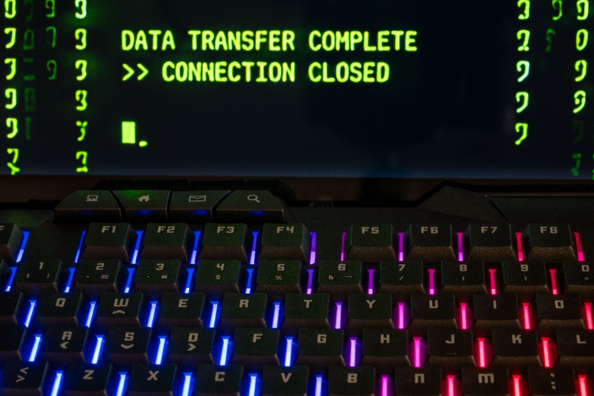

[Español](/es/security/engineering/leadership/opinion/2026/11/11/500ms-between-global-collapse-and-security) \| **English** \| [Português](/pt/security/engineering/leadership/opinion/2026/11/11/500ms-between-global-collapse-and-security)

{:.ai-editorial}

{:.eyebrow-label}
// CyberSecurity · ZeroTrust · TechLeadership · Engineering

{:.ai-lead}
**On March 29, 2024, the internet almost broke in silence.**

There were no alarms in corporate data centers or warnings from intelligence agencies. The salvation of the global tech ecosystem came from a PostgreSQL engineer named Andres Freund. His primary tool? An obsessive irritation over a nearly imperceptible anomaly: his SSH logins were taking 500 milliseconds longer than normal.

Half a second. Most developers would have blamed network latency, shrugged it off, and gone back to work. Freund pulled the thread on that delay and exposed **CVE-2024-3094**, a malicious backdoor injected into the `xz-utils` library. It constituted one of the most patient and sophisticated software supply chain attacks in history.

Had that half-second been ignored, attackers would have gained superuser access to countless Linux servers worldwide. This averted crisis is not just a cybersecurity anecdote; it is an empirical testament to the critical importance of being detail-oriented. And it is a threat that, today, no longer discriminates by company size or target.

---

{:.section-tag}
// 01

## The Invisible Threat in the Inbox

Being a tech giant is not required to be targeted by state actors. In daily professional operations, there is documented evidence of multiple sophisticated impersonation attempts designed for corporate infiltration.

{: width="100%" }

The goal is chillingly simple: bypass Western recruitment filters, secure B2B contracts with companies in the US or Europe, and gain silent access to private source code repositories. Tactics have evolved; network infrastructures are no longer the sole targets—the human talent supply chain is being breached.

If an engineer, a tech lead, or an executive lacks rigorous attention to detail—from inspecting email metadata to auditing the permissions of a new collaborator's first commit—the company is compromised before the first line of code is written.

---

{:.section-tag}
// 02

## Cultivating Constructive Paranoia: The Path to "Zero-State-Ready"

The technical conclusion is inevitable: an obsession with detail is not a "soft skill." It is a fundamental survival mechanism. This mindset does not magically activate during a cybersecurity crisis; it is trained daily in the local environment.

A recent audit of a macOS development environment illustrates this principle. At first glance, the terminal operated normally. However, upon executing a boot profiling, the numbers revealed an unacceptable anomaly:

```bash
time zsh -i -c exit
zsh -i -c exit  0.37s user 0.32s system 95% cpu 0.719 total
```

`0.719` seconds. Imperceptible to most. To a mind trained to detect friction, it equated to the 500ms of the SSH case. There was an unjustified process overhead.

Using Zsh's native `zprof` module, the operating system's boot load was dissected millisecond by millisecond. The analysis exposed silent performance killers: a redundant `compinit` initialization caused by Docker autocomplete colliding with the Zsh framework, an I/O block from synchronous Python binary scanning (`pyenv rehash`), and uncompiled cache dumps.

But pure optimization is meaningless without a security architecture. The design required implementing a proactive shield against local vulnerabilities. Instead of delegating control to automated package updates, a direct security interceptor was designed within the interactive initialization script of the Zsh shell.

The result is `brew_safe_upgrade`, a function that audits application states before allowing the package manager to interact with the disk:

```bash
function brew_safe_upgrade() {
    echo "\n🔍 Analyzing pending updates (Greedy Mode)..."
    local apps
    apps=$(command brew outdated --cask --greedy --quiet)

    if [ -n "$apps" ]; then
        echo "🛑 DANGER: Potential database corruption. Process termination required."
        # ... (Strict interactive validation required)
        echo -n "\nConfirm application isolation to proceed? (y/n): "
        local respuesta
        read -r respuesta
        if [[ "$respuesta" =~ ^[Yy]$ ]]; then
            echo "\n🚀 Initiating safe upgrade..."
            command brew upgrade --greedy
        else
            echo "\n❌ Upgrade aborted. Privileges retained for environment security."
        fi
    else
        echo "✅ Validation successful. Proceeding with CLI libraries..."
        command brew upgrade --greedy
    fi
}
```

This represents the Zero-Trust philosophy applied to daily dependency management. It is not assumed that the environment is secure by default; the environment is forced to prove its integrity.

---

{:.section-tag}
// 03

## The Result: Engineering Without Concessions

After relocating dependencies, applying asynchronous lazy-loading to cloud SDKs, precompiling dictionaries (`.zwc`), and purging the execution tree, the new measurement yielded the following result:

```bash
time zsh -i -c exit
zsh -i -c exit  0.10s user 0.10s system 101% cpu 0.193 total
```

From 719 milliseconds to **193 milliseconds**.

Beyond the speed metric, an architectural standard dubbed **Zero-State-Ready** was achieved: a hermetic, predictable, and validated environment. A system where interpreter isolation is absolute, the attack surface is minimized from boot, and every variable in memory has a deterministic justification.

Technical excellence in leadership is not about stacking AI tools or memorizing emerging frameworks. It is about questioning load times, reviewing the governance of cryptographic keys, and meticulously auditing unusual connection requests on LinkedIn.

The global open-source ecosystem was saved thanks to an engineer who cared about a half-second of latency. To survive the next generation of asymmetric threats, the first step is taking responsibility for the very milliseconds under one's control.

---

{:.footnotes}
*Published on November 11th, 2026 · Cybersecurity and Technical Leadership*

*Tags: #CyberSecurity #Engineering #ZeroTrust #TechLeadership #SoftwareDevelopment*
