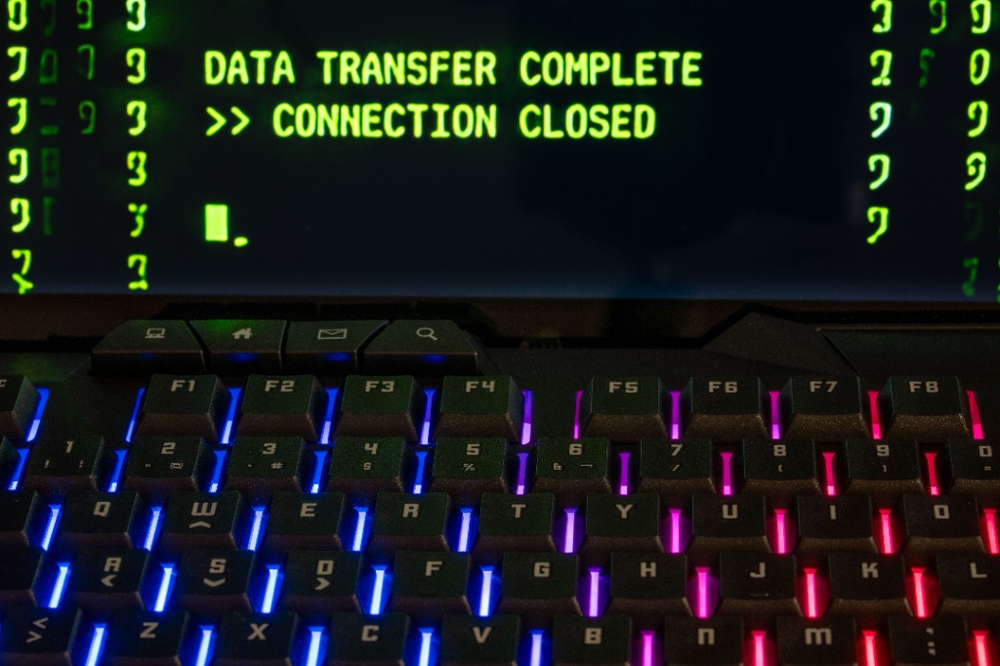

**Español** \| [English](/security/engineering/leadership/opinion/2026/11/11/500ms-between-global-collapse-and-security) \| [Português](/pt/security/engineering/leadership/opinion/2026/11/11/500ms-between-global-collapse-and-security)

{:.ai-editorial}

{:.eyebrow-label}
// CyberSecurity · ZeroTrust · TechLeadership · Engineering

{:.ai-lead}
**El 29 de marzo de 2024, el internet estuvo a punto de romperse en silencio.**

No hubo alarmas en los centros de datos de las grandes corporaciones ni advertencias de agencias de inteligencia. La salvación del ecosistema tecnológico global provino de un ingeniero de PostgreSQL llamado Andres Freund. ¿Su herramienta principal? Una irritación obsesiva por una anomalía casi imperceptible: sus inicios de sesión por SSH estaban tardando 500 milisegundos más de lo normal.

Medio segundo. La mayoría de los desarrolladores habrían culpado a la latencia de la red, se habrían encogido de hombros y habrían vuelto al trabajo. Freund tiró del hilo de ese retraso y expuso el **CVE-2024-3094**, una puerta trasera maliciosa inyectada en la librería `xz-utils`. Constituyó uno de los ataques a la cadena de suministro de software (*supply chain*) más pacientes y sofisticados de la historia.

Si ese medio segundo hubiera sido ignorado, los atacantes habrían obtenido acceso de superusuario a incontables servidores Linux en todo el mundo. Esta crisis evitada no es solo una anécdota de ciberseguridad; es un testamento empírico sobre la importancia crítica de la orientación al detalle. Y es una amenaza que, en la actualidad, ya no discrimina ni el tamaño de la empresa ni el objetivo.

---

{:.section-tag}
// 01

## La Amenaza Invisible en la Bandeja de Entrada

No se requiere ser un gigante tecnológico para estar en la mira de actores estatales. En la operación profesional diaria, existen evidencias documentadas de múltiples intentos sofisticados de suplantación de identidad (*impersonation*) diseñados para la infiltración corporativa.

{: width="100%" }

El objetivo es escalofriantemente simple: superar los filtros de reclutamiento occidentales, conseguir contratos B2B con empresas en EE. UU. o Europa, y obtener acceso silencioso a repositorios de código fuente privados. Las tácticas han evolucionado; ya no se atacan exclusivamente infraestructuras de red, se está vulnerando la cadena de suministro del talento humano.

Si un ingeniero, un *tech lead* o un directivo carece de una rigurosa atención al detalle, desde inspeccionar los metadatos de un correo electrónico hasta auditar los permisos del primer *commit* de un nuevo colaborador, la empresa está comprometida antes de que se escriba la primera línea de código.

---

{:.section-tag}
// 02

## Cultivando la Paranoia Constructiva: El Camino al "Zero-State-Ready"

La conclusión técnica es inevitable: la obsesión por el detalle no es una "habilidad blanda" (*soft skill*). Es un mecanismo fundamental de supervivencia. Esta mentalidad no se activa por arte de magia durante una crisis de ciberseguridad; se entrena diariamente en el entorno local.

Una auditoría reciente a un entorno de desarrollo en macOS ilustra este principio. A simple vista, la terminal operaba con normalidad. Sin embargo, al ejecutar un perfilado de arranque, los números revelaron una anomalía inaceptable:

```bash
time zsh -i -c exit
zsh -i -c exit  0.37s user 0.32s system 95% cpu 0.719 total
```

`0.719` segundos. Para la mayoría, imperceptible. Para una mente entrenada en detectar fricciones, equivalía a los 500ms del caso SSH. Existía un *overhead* de procesos injustificado.

Utilizando el módulo `zprof` nativo de Zsh, se diseccionó la carga del sistema operativo milisegundo a milisegundo. El análisis expuso "asesinos silenciosos" de rendimiento: una inicialización redundante de `compinit` causada por el autocompletado de Docker colisionando con el framework de Zsh, un bloqueo de I/O por el escaneo síncrono de binarios de Python (`pyenv rehash`), y volcados de caché no compilados.

Pero la optimización pura carece de sentido sin una arquitectura de seguridad. El diseño requería implementar un escudo proactivo contra vulnerabilidades locales. En lugar de delegar el control a las actualizaciones automatizadas de paquetes, se diseñó un interceptor de seguridad directo en el script de inicialización interactiva de la shell Zsh.

El resultado es `brew_safe_upgrade`, una función que audita el estado de las aplicaciones antes de permitir que el gestor de paquetes interactúe con el disco:

```bash
function brew_safe_upgrade() {
    echo "\n🔍 Analizando actualizaciones pendientes (Modo Greedy)..."
    local apps
    apps=$(command brew outdated --cask --greedy --quiet)

    if [ -n "$apps" ]; then
        echo "🛑 PELIGRO: Posible corrupción de bases de datos. Se requiere cierre de procesos."
        # ... (Validación interactiva estricta requerida)
        echo -n "\n¿Confirmas el aislamiento de las aplicaciones para continuar? (s/n): "
        local respuesta
        read -r respuesta
        if [[ "$respuesta" =~ ^[SsYy]$ ]]; then
            echo "\n🚀 Iniciando actualización segura..."
            command brew upgrade --greedy
        else
            echo "\n❌ Actualización abortada. Privilegios retenidos por seguridad del entorno."
        fi
    else
        echo "✅ Validación exitosa. Procediendo con librerías CLI..."
        command brew upgrade --greedy
    fi
}
```

Esto representa la filosofía *Zero-Trust* aplicada a la gestión de dependencias diarias. No se asume que el entorno es seguro por defecto; se obliga al entorno a demostrar su integridad.

---

{:.section-tag}
// 03

## El Resultado: Ingeniería sin Concesiones

Tras reubicar dependencias, aplicar carga asíncrona (*lazy-loading*) a los SDKs de la nube, precompilar diccionarios (`.zwc`) y purgar el árbol de ejecución, la nueva medición arrojó el siguiente resultado:

```bash
time zsh -i -c exit
zsh -i -c exit  0.10s user 0.10s system 101% cpu 0.193 total
```

De 719 milisegundos a **193 milisegundos**.

Más allá de la métrica de velocidad, se alcanzó un estándar arquitectónico denominado **Zero-State-Ready**: un entorno hermético, predecible y validado. Un sistema donde el aislamiento de intérpretes es absoluto, la superficie de ataque se minimiza desde el arranque, y cada variable en memoria cuenta con una justificación determinista.

La excelencia técnica en el liderazgo no consiste en apilar herramientas de IA ni en memorizar *frameworks* emergentes. Se trata de cuestionar los tiempos de carga, revisar la gobernanza de las claves criptográficas y auditar meticulosamente las solicitudes inusuales de conexión en LinkedIn.

El ecosistema global de código abierto se salvó gracias a un ingeniero al que le importó medio segundo de latencia. Para sobrevivir a la próxima generación de amenazas asimétricas, el primer paso es responsabilizarse de los propios milisegundos.

---

{:.footnotes}
*Publicado el 11 de noviembre de 2026 · Ciberseguridad y Liderazgo Técnico*

*Etiquetas: #CyberSecurity #Engineering #ZeroTrust #TechLeadership #SoftwareDevelopment*
